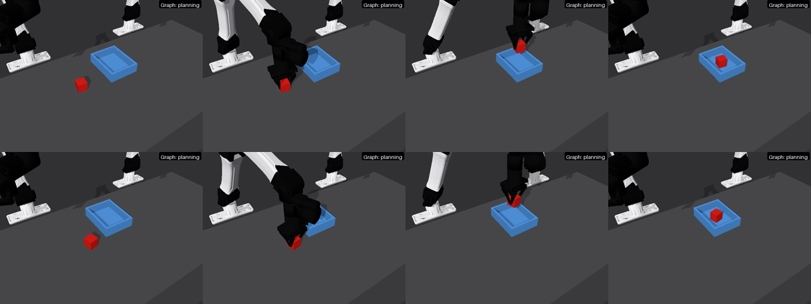

# Example: "pick up the red cube and put it in the tray"

One arm picks a 40 mm red cube off the bench and sets it down in an open tray.
The agent started from the instruction alone and learned the policy in
[`policy/`](policy) in three iterations, reading the paper's reference
feedback condition.



## The task

- **Scene.** RoboSimStudio's `bench_075` bench with an i2rt YAM pair. The right
  arm does the work; the left stays parked.
- **Objects.** A 40 mm red cube, and a tray built from five primitive boxes: a
  floor and four walls, 160 x 120 mm inside and 45 mm tall
  ([`tasks/cube_in_tray/`](tasks/cube_in_tray)).
- **Parts.** The cube declares its `body` (a grasp box) and its `up` axis,
  and the tray one `face` per box ([`records.py`](tasks/cube_in_tray/records.py)).
  They are the vocabulary of `spatial: parts` feedback.
- **Goal.** The cube's centre inside the tray, resting on it, with every hand
  more than 10 cm away, held for one simulated second. The task's evaluator
  scores every episode.
- **Budget.** 1200 control steps per episode, 20 s at 60 Hz.

Every episode draws these quantities ([`staging.py`](tasks/cube_in_tray/staging.py)):

| Quantity | Range |
|---|---|
| Cube position on the bench | 11 cm x 11 cm |
| Cube yaw | -45° to 45° |
| Tray position on the bench | 8 cm x 7 cm |
| Cube mass | 30 to 150 g |
| Cube friction | 0.5 to 1.0 |
| Tray friction | 0.4 to 1.0 |

Training uses episodes 0–5, and the held-out set is episodes 20–25.

The policy may call the tools in [`tools.json`](tools.json):
- the robot's motion and gripper tools;
- the joint and straight-line planners;
- ground-truth reads of object poses and of the goal region's box.

The evaluator's verdict is not among them.

## Configs

[`config.yaml`](config.yaml) is the reference condition (`form: [state, relations]`,
`spatial: parts`, `granularity: semantic`) with Claude Opus 5.5.
[`configs/`](configs) overlays it with one feedback condition each, a Codex
agent, and a skill library; see [docs/guide/feedback.md](../../docs/guide/feedback.md).

```bash
uv run asl-run --config examples/cube_in_tray/configs/motion.yaml --set execution.gpu=0
```

## The run

One run with [`config.yaml`](config.yaml):
- Claude Opus 5.5 on one GPU, with `--set loop.max_usd=6` (the cap never bound: the run spent $4.67);
- the robosimstudio and graph-as-policy revisions that [`pyproject.toml`](../../pyproject.toml) pins;
- before the config's `off_limits` line was added. The session's transcript
  shows no read outside its workspace.

| Iteration | Train | Held-out | Agent cost, cumulative |
|---|---|---|---|
| k0 | 0/6 | 0/6 | $1.96 |
| k1 | 0/6 | — | $3.14 |
| k2 | 6/6 | 6/6 | $4.36 |
| k3 | 6/6 | 6/6 | $4.67 |

The run stopped after two perfect training batches in a row. It took 37
minutes end to end and delivered k3, which is k2's policy: at k3 the agent saw
nothing to fix and changed nothing. The cost is the CLI's, and repricing from
the session's tokens gives the same $4.67.

What the agent changed, from its own summaries:

- **k0 → k1.** The first policy grasped the cube in every episode, then lifted
  it toward the arm's starting height, which the arm cannot reach while holding
  the cube. The lift crawled until the episode ran out of steps; the feedback
  showed the move ending 0.119 m short of its target after 855 steps. The agent
  now lifts only as high as the tray's walls need, read from the tray each
  episode, and tries a joint-space plan before the slow straight-line move.
- **k1 → k2.** Now every episode set the cube down inside the tray, resting
  and upright, and still none succeeded. The feedback's end state said the
  cube was inside the tray; it could not say which of the evaluator's clauses
  failed. The agent guessed the hand had to be clear of the cube. It added a
  step that lifts off and sends the arm home, and trimmed waits to pay for it.
  The guess was right.

## The delivered policy

[`policy/`](policy) is the k3 workflow: `workflow.json` and the scripts it
runs. Four subgraphs run in sequence: perceive, pick, place and verify. A
failed pick is retried once; verify first clears the hand from the cube and
sends the arm home.

Re-run on the held-out episodes with video, the delivered copy scored 6/6:

```bash
uv run asl-rollout --config examples/cube_in_tray/config.yaml --graph examples/cube_in_tray/policy
```

## Reproduce

```bash
git -C /path/to/robosimstudio checkout 87b5e32   # the revision this run used
ROBOSIMSTUDIO_REPO=/path/to/robosimstudio \
  uv run asl-run --config examples/cube_in_tray/config.yaml --set execution.gpu=0
```

This is one run on six training and six held-out episodes. Another run writes a
different first policy, and its curve will differ.
